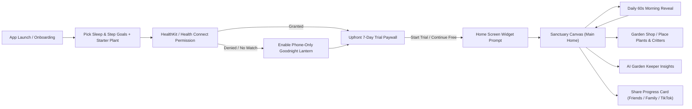

# PRD — Cozy Living Sanctuary (Working Title: *Dew & Bloom*)

> **Version:** V1.0  
> **Date:** 2026-11-24  
> **Author:** Founder & Product Strategy  
> **Status:** Ready for Technical Design & Agentic Implementation Planning  
> **Supersedes:** Initial concept in [README.md](../README.md)

---

## 1. Revision History

| Version | Date | Author | Summary of Changes |
|---|---|---|---|
| V1.0 | 2026-11-24 | Founder & AI PM | Initial execution-ready PRD pivoting from generic XP tracker to Passive Sleep & Steps → Cozy Living Sanctuary (iOS & Android, Global English, Freemium + 7-Day Trial). |

---

## 2. Background, Vision & Mission

### 2.1 Executive Summary
**Your sleep and daily steps automatically grow a cozy, living garden right on your phone's home screen — zero manual logging, zero homework.** Unlike punishing habit trackers that kill your streak over one rough night, a missed day only brings a gentle morning fog that clears on your next good rest, while a lightweight AI Garden Keeper spots the real patterns behind your best energy. Our mission is to turn healthier sleep and daily movement into a calm 60-second morning ritual people genuinely look forward to — and happily pay **$1.66/month** to keep growing.

### 2.2 Market & Psychological Rationale
- **Why not a generic XP/mission tracker:** Pure XP/levels trigger the Overjustification Effect and manual-logging fatigue, causing Day-7 to Day-14 churn. Health & Fitness apps generate **2x+ higher revenue per install** than Productivity apps and achieve ~68% annual subscription adoption (RevenueCat 2025–2026 benchmarks).
- **What users get out of this app:**
  1. **Better sleep consistency & less bedtime doomscrolling** without clinical graphs or sleep-anxiety.
  2. **More daily walking/movement** passively rewarded in the background.
  3. **A calming 60-second morning ritual** where real-world health visibly grows a personal sanctuary (Endowment + IKEA Effect).
  4. **Zero guilt on hard days** — compassionate "morning fog" replaces punitive streak-death spirals.
  5. **Actionable 1-line AI insights** connecting daily habits to real sleep quality, plus easy progress sharing with friends and family.

---

## 3. Overview Summary

| Item | Details |
|---|---|
| **Product Category** | Health & Fitness (App Store & Google Play) |
| **Target Platforms** | **iOS & Android simultaneously** (React Native + Expo + EAS Build) |
| **Language & Market** | Global English (US, UK, CA, AU, EU Tier-1 first; open to everyone) |
| **Core Screens (v1)** | Onboarding & Personalization, Health Sync Setup, Trial Paywall, Morning Reveal Modal, Sanctuary Canvas (Home), Garden Catalog/Inventory, AI Insights & Trends, Share Progress Card, Settings & Profile, Native Home Screen Widget |
| **Core Value Proposition** | Passive Sleep + Steps → Dew & Sunlight → Grow & Decorate a Cozy Sanctuary on your Home Screen |
| **Monetization Model** | Freemium + Honest Upfront 7-Day Free Trial (**$19.99/yr**, $2.99/mo, $39.99 Lifetime; clear "Continue Free" option) |
| **6-Month Success Targets** | **$1,000–$2,000 MRR**, D7 Retention ≥ 30%, Trial-to-Paid Conversion ≥ 35%, App Store / Play Store Rating ≥ 4.7★ |
| **Design Mockups** | > ⚠️ TBD — To be created in design phase |

---

## 4. Product Requirements

### 4.0 User Flow Overview (Cross-Page Flow)

| Flow Step | Screen | User Action | Key Metric | Branch Condition |
|---|---|---|---|---|
| 1. First Open | Onboarding (3–4 steps) | Choose target sleep hours (e.g., 7.5h), daily step goal (e.g., 6,000), and starter seedling | Onboarding Completion Rate (target ≥ 75%) | Always shown once on first install |
| 2. Data Hook | Health Sync Setup | Grant Apple Health / Android Health Connect read permissions (Sleep + Steps) | Health Sync Opt-in Rate (target ≥ 65%) | If denied or no wearable → fallback to Phone-Only mode |
| 3. Monetization | Onboarding Paywall | Start 7-day free trial ($19.99/yr), buy Lifetime ($39.99), or tap "Continue Free" | Day-1 Trial Start Rate (target ≥ 8–12%) | Always offers visible, non-deceptive "Continue Free" |
| 4. Retention Hook | Widget Setup Guide | Pin live Sanctuary Widget to iOS/Android Home Screen | Day-1 Widget Install Rate (target ≥ 35%) | Skippable; re-prompted gently on Day 3 |
| 5. Daily Loop | Morning Reveal → Sanctuary | Tap to clear morning fog, collect overnight **Dew** (sleep) & **Sunlight** (steps), read 1-line AI insight, place 1 new plant/decor | D1 / D7 / D30 Retention | Triggers automatically on first app open after wake window |
| 6. Sharing | Share Progress Card | Export stylized garden snapshot / 7-day bloom card to Messages, WhatsApp, IG Stories, or TikTok | Share Rate & Organic Installs | Accessible from Sanctuary Canvas & Weekly Summary |

**Inter-Screen Data Passing:**
- Onboarding → Sanctuary Canvas: passes `sleep_goal_minutes`, `step_goal`, `starter_plant_id`, `tracking_mode` (`health_sync` | `phone_only`).
- Health Sync / Goodnight Lantern → Morning Reveal: passes `last_night_sleep_minutes`, `sleep_quality_tier`, `yesterday_steps`, `earned_dew`, `earned_sunlight`, `fog_level`.
- Sanctuary Canvas → Share Card: passes current rendered garden snapshot, `days_tended`, `weekly_sleep_avg`, `weekly_steps_avg`.

---

### 4.0b User Segments & Differentiation

**User Segmentation Rules:**

| Segment | Definition / Detection Rule | Est. Share |
|---|---|---|
| **Wearable / Health-Sync Users** | Granted Apple HealthKit or Android Health Connect access AND device reports sleep + step records | ~55% |
| **Phone-Only Users** | No smartwatch/sleep tracker OR denied OS Health permissions (uses phone pedometer + 1-tap Goodnight Lantern) | ~45% |
| **Free Users** | Active account with no active RevenueCat entitlement | ~88–92% |
| **Pro Subscribers** | Active 7-day trial, Monthly ($2.99), Annual ($19.99), or Lifetime ($39.99) entitlement | ~8–12% |

**Differentiation Matrix:**

| Dimension | Free Tier | Pro Tier ($19.99/yr) |
|---|---|---|
| **Core Sleep + Steps Tracking** | Full access (Health Sync + Phone-Only) | Full access |
| **Starter Biome ("Sunlit Meadow")** | Full access + 15 core plants & decor | Full access + all 35+ v1 plants, lanterns, ponds & rare critters |
| **Live Home Screen Widget** | Basic widget (garden snapshot) | All widget sizes + live time-of-day sky/weather sync |
| **AI Garden Keeper** | 1 weekly summary insight | Daily personalized 1-line insight + weekly sleep↔step correlation |
| **History & Trends** | Last 7 days | Unlimited history + 30-day garden time-lapse export |
| **v1.5 Expansion Included** | Join a Pro friend's Duo Garden (1 guest slot) | Host Duo Shared Gardens + unlock all seasonal biomes |

**Segment Switching & Fallback Logic:**
- If a Wearable user forgets to wear their watch for a night (0 sleep records detected by 11:00 AM), the app prompts a gentle 1-tap fallback: *"Forgot your watch? Tap roughly how you slept"* (Restful / Okay / Rough) so they never lose their morning reveal.
- If a Pro subscription expires, **already-placed Pro plants remain visible in the user's garden forever** (zero punitive deletion); only placing *new* Pro items or accessing unlimited history locks until renewal.

---

### 4.1 Frontend Requirements (iOS & Android Simultaneous Build)

#### 4.1.1 Mobile App Screens (React Native + Expo)
1. **Onboarding Flow (4 lightweight screens):**
   - Visual preview of a blooming isometric sanctuary before asking for anything.
   - Sliders for Sleep Goal (default 7.5h, range 6h–10h) and Daily Step Goal (default 6,000, range 2,000–15,000).
   - Pick 1 of 3 starter seedlings (Lavender, Bonsai Sprout, Sunlit Fern).
   - Native Health permission explanation screen (plain-English privacy assurance: *"Your health data stays private and is never sold"*).
2. **Sanctuary Canvas (Main Home Screen):**
   - Full-bleed 2D isometric garden grid (e.g., 8x8 or 10x10 tile diamond) with smooth pan/zoom, gentle ambient animations (swaying leaves, drifting fireflies at night, morning mist overlay when fog > 0).
   - Top HUD (minimal, non-cluttered): **Dew** balance (sleep currency), **Sunlight** balance (step currency), and **Garden Harmony** indicator (rolling 7-day consistency, e.g., "5 of 7 restful days" — no rigid streak counter).
   - Bottom action dock (4 clean buttons): **Morning Reveal / Goodnight Lantern**, **Build / Shop**, **AI Insights**, **Share**.
   - Tap-to-place & tap-to-move editing mode for plants, stones, ponds, lanterns, and visiting critters.
3. **Morning Reveal Modal (60-Second Daily Ritual):**
   - Shows last night's sleep summary + yesterday's step summary in warm, human language (not sterile charts).
   - Interactive "Swipe / Tap to Clear Morning Mist" gesture with gentle haptics (`expo-haptics`).
   - Awards **Dew** and **Sunlight**, reveals if a rare critter (hedgehog, robin, firefly, koi) visited overnight, and displays the **AI Garden Keeper's 1-line note**.
4. **Phone-Only "Goodnight Lantern" Mode:**
   - Optional 1-tap button at bedtime that dims the screen into a cozy glowing lantern/wind-down state; tapping "I'm Awake" in the morning calculates rest duration cleanly without draining battery.
5. **AI Garden Keeper & Trends Screen:**
   - Displays today's 1-line personalized insight + 7-day (Free) or 30-day (Pro) visual sleep & step rhythm bars.
6. **Share Progress Card:**
   - Generates a high-aesthetic 9:16 (Stories/TikTok) or 1:1 (WhatsApp/Messages) image card showing the user's current garden + subtle stats (*"14 days of better sleep grew this sanctuary"*) + subtle app watermark/link.
7. **Native Home Screen Widgets (iOS WidgetKit + Android AppWidget):**
   - Small (2x2) and Medium (4x2) widgets displaying the user's live garden snapshot, current weather/mist state, and today's Dew/Sunlight bloom progress.

**Testable Acceptance Criteria (QA):**
- [ ] Cold start to interactive Sanctuary Canvas completes in < 2.0 seconds on mid-range iOS & Android devices.
- [ ] When HealthKit / Health Connect returns 7.5h sleep and 6,000 steps, Morning Reveal triggers once per calendar day and credits the exact server-calculated Dew and Sunlight amounts.
- [ ] When a user misses 2 consecutive days, zero placed plants are deleted; a semi-transparent Morning Fog layer renders at 50% opacity and clears immediately upon completing the next valid rest/walk day.
- [ ] Tapping "Continue Free" on the onboarding paywall dismisses the paywall immediately without secondary guilt modals or countdown timers.
- [ ] Placing, moving, or removing a plant on the isometric grid persists locally and syncs to Supabase within 2 seconds while online, and queues cleanly when offline.
- [ ] Native Home Screen Widget updates within 30 minutes of a Morning Reveal or garden edit on both iOS and Android.

#### 4.1.2 Cross-Platform Differences Summary (iOS vs. Android)

| Dimension | iOS (React Native + Expo) | Android (React Native + Expo) |
|---|---|---|
| **Passive Health API** | Apple HealthKit (`react-native-health` / Expo config plugin) | Android Health Connect (`react-native-health-connect`) |
| **Home Screen Widget** | SwiftUI WidgetKit Extension via Expo config plugin (`@bacons/apple-targets` or custom plugin) | Kotlin Jetpack Glance / AppWidgetProvider via Expo config plugin |
| **Authentication** | Sign in with Apple (mandatory if Google auth offered) + Google + Email | Google Sign-In + Email |
| **Billing & Subscriptions** | StoreKit 2 via RevenueCat SDK | Google Play Billing via RevenueCat SDK |
| **Haptics** | Core Haptics (`expo-haptics` light/medium/success) | Android VibrationEffect (`expo-haptics`) |

---

### 4.2 Data & Business Logic

#### 4.2.1 Resource Economy (Server-Validated)
- **Dew (Sleep Currency):**
  - Earned once per calendar day (user's local timezone).
  - Base formula: reaching ≥ 85% of personal sleep goal = **100 Dew**; 65–84% = **70 Dew**; < 65% (or rough night check-in) = **40 Dew** *(always rewards showing up; never zero)*.
  - Bonus: Bedtime within ±45 min of personal target window = **+25 Dew**.
- **Sunlight (Steps / Movement Currency):**
  - Earned continuously throughout the day up to a daily cap (prevents step-shaker abuse).
  - Formula: **10 Sunlight per 1,000 steps**, capped at **150 Sunlight/day** (15,000 steps).
  - Reaching personal daily step goal = **+30 Bonus Sunlight**.
- **Anti-Cheat Sanity Bounds:**
  - Server rejects impossible single-day payloads (> 16 hours sleep or > 60,000 steps/day) and clamps rewards gracefully without accusing the user.

#### 4.2.2 Compassionate Morning Fog Logic (Anti-Guilt Retention)
- **0 missed days:** `fog_level = 0` (Clear, sunlit/starlit garden; wildlife visits active).
- **1 missed day:** `fog_level = 1` (Light morning dew/mist — purely atmospheric).
- **2–3 missed days:** `fog_level = 2` (Gentle cozy fog covers 50% of garden; critters nap).
- **4+ missed days:** `fog_level = 3` (Full calm mist; **no plants ever die or disappear**).
- **Instant Recovery:** Completing **1 single day** (any logged sleep or ≥ 2,000 steps) resets `fog_level = 0` with a gratifying "Clearing the Mist" animation.

#### 4.2.3 AI Garden Keeper Logic
- Triggered asynchronously via Supabase Edge Function at most **1x/day (Pro)** or **1x/week (Free)**.
- **Input payload (anonymized summary only, no PII):** last 7 days of `{sleep_hours, bedtime_offset_min, steps, fog_level}`.
- **Output:** Strict JSON `{ "insight": "<max 22 words, warm cozy tone, 1 concrete observation or gentle suggestion>", "mood_tag": "restful|energized|recovering" }`.
- **Cost Control:** Uses a fast, low-cost model (e.g., Gemini Flash / GPT-4o-mini) — estimated cost **< $0.0005/user/day** (< $0.02/month per active Pro user).
- **Safety Rules:** Never gives medical diagnoses, never shames low numbers, never recommends extreme sleep restriction or over-exercising.

---

### 4.3 Admin / Content Catalog Needs

No heavy custom admin panel is needed for v1.
- Garden catalog (plants, decor, critters, biomes, Dew/Sunlight costs, Pro flags, asset keys) is managed as a versioned **Supabase table (`catalog_items`)** seeded from a checked-in JSON manifest in the repo.
- Adding new seasonal plants or adjusting costs can be pushed via Supabase migrations without requiring an App Store binary resubmission (when using remote-cached sprite bundles or pre-bundled seasonal sets).

---

### 4.4 Backend & API Requirements

#### PM Business Layer
- **Core Capabilities Needed:**
  1. User authentication & profile preferences (sleep goal, step goal, timezone, tracking mode).
  2. Daily health summary ingestion & server-side reward calculation (Dew, Sunlight, Fog Level, Harmony score).
  3. Garden state persistence (list of unlocked items + `(x, y)` grid coordinates on the user's sanctuary).
  4. AI Garden Keeper endpoint (rate-limited, cached per user per day).
  5. Subscription entitlement sync via RevenueCat webhooks (source of truth for Free vs. Pro).
  6. Push notification scheduling (gentle optional morning reveal reminder + optional bedtime wind-down nudge).
- **Performance Expectation:** All garden read/write & sync endpoints respond in **< 300ms p95**; AI insight endpoint responds in **< 2.5s** (with non-blocking UI skeleton).

#### Engineering Technical Layer
> ⚠️ **To be finalized during technical design / implementation plan** (structured below to support parallel AI agent / subagent / swarm development).

- **Stack:** Supabase (PostgreSQL + Auth + Row Level Security + Edge Functions in TypeScript) + RevenueCat + PostHog + Sentry.
- **Core Database Tables:**
  - `profiles` (id, timezone, sleep_goal_min, step_goal, tracking_mode, dew_balance, sunlight_balance, fog_level, is_pro, created_at)
  - `daily_logs` (id, user_id, log_date, sleep_min, steps, source, dew_awarded, sunlight_awarded, revealed_at, ai_insight)
  - `catalog_items` (id, slug, category, name, dew_cost, sunlight_cost, is_pro, asset_key)
  - `garden_placements` (id, user_id, biome_id, item_id, grid_x, grid_y, placed_at)
  - `subscriptions` (user_id, rc_customer_id, plan_type, status, expires_at)
- **Modular Subagent / Swarm Workstreams (Parallel Build Map):**
  - *Agent Stream 1 (App Shell & Auth):* Expo Router navigation, Supabase Auth (Apple/Google/Email), Onboarding flow.
  - *Agent Stream 2 (Health Integrations):* Apple HealthKit + Android Health Connect adapters + Phone-Only Goodnight Lantern fallback.
  - *Agent Stream 3 (Sanctuary Canvas Engine):* 2D isometric grid renderer, plant placement/pan/zoom, morning fog & reveal animations, Share Card generator.
  - *Agent Stream 4 (Backend & AI):* Supabase schema, RLS policies, reward-calculation RPC/Edge Function, AI Garden Keeper Edge Function, RevenueCat webhook.
  - *Agent Stream 5 (Widgets & Monetization):* RevenueCat paywall integration, PostHog analytics, iOS WidgetKit & Android Glance widget extensions.

---

### 4.6 Content & Art Asset Specifications

- **Visual Direction:** Warm, tactile, cozy 2D isometric illustration (hand-painted / Studio Ghibli / Stardew / Finch-adjacent warmth; soft daylight & cozy starlit night palettes — *never* sterile dark-mode SaaS or medieval RPG clutter).
- **v1 Asset Scope (Tight & Shippable):**
  - **1 Starter Biome:** *Sunlit Meadow* (day & night sky variants).
  - **35 Modular Sprites:** 18 plants/trees/flowers, 10 cozy decor items (stone paths, lanterns, wooden bench, pond, greenhouse), 7 visiting critters (robin, hedgehog, firefly, butterfly, frog, cat, koi).
- **Technical Asset Constraints:**
  - Isometric tile base: 2:1 diamond ratio, exported at `@3x` transparent WebP/PNG (max 150 KB per sprite; total v1 art bundle < 15 MB).
  - Ambient motion: lightweight Reanimated / Lottie loops (no heavy 3D Unity/Three.js runtime to keep battery usage near zero).

---

## 5. Data, Monetization & Experimentation Requirements

### 5.1 Analytics Event Tracking (PostHog)

| Event Name | Trigger | Key Properties |
|---|---|---|
| `onboarding_started` / `onboarding_completed` | User starts / finishes onboarding | `sleep_goal`, `step_goal`, `starter_plant` |
| `health_permission_result` | OS Health dialog closes | `platform`, `status` (`granted`\|`denied`\|`skipped`) |
| `paywall_viewed` | Onboarding or in-app paywall shown | `placement` (`onboarding`\|`shop`\|`insights`), `offering_id` |
| `trial_started` / `subscription_purchased` | RevenueCat confirms purchase | `plan` (`annual`\|`monthly`\|`lifetime`), `price_usd` |
| `morning_reveal_completed` | User clears mist & collects Dew/Sunlight | `sleep_min`, `steps`, `fog_level_cleared`, `source` |
| `garden_item_placed` | User buys/places an item | `item_slug`, `is_pro_item`, `total_items_placed` |
| `widget_installed` | App detects active home screen widget | `platform`, `widget_size` |
| `progress_card_shared` | User exports/shares garden card | `share_channel`, `days_tended` |

### 5.2 A/B Testing Plan (Post-Launch via RevenueCat + PostHog)

| Item | Details |
|---|---|
| **Test Owner** | Founder |
| **Background** | Optimizing annual price point for paid TikTok/Meta ad payback without hurting App Store ratings. |
| **Hypothesis** | Testing **$19.99/yr** (V0) vs. **$24.99/yr** (V1) with a 7-day free trial will identify which price maximizes 35-day Revenue Per Install (RPI). |
| **Trigger** | First-time onboarding paywall impression (50/50 random split). |
| **Primary Metric** | 35-Day Revenue Per Install (RPI) & Trial-to-Paid Conversion Rate. |
| **Observation Metrics** | Day-1 Trial Start Rate, D7 Retention, Refund Rate, App Store Rating. |

---

## 6. Non-Functional Requirements

### 6.1 Performance
- **Cold Start:** < 2.0s to Sanctuary Canvas.
- **Frame Rate:** Steady 60fps pan/zoom and mist-clearing animation on iPhone 12+ and equivalent mid-range Android devices.
- **Battery Impact:** Near-zero background drain (reads OS Health stores on app foreground + scheduled lightweight widget refresh; zero continuous GPS polling).

### 6.2 Fault Tolerance & Fallbacks
- **Offline Support:** Sanctuary viewing, plant placement, and Goodnight Lantern work 100% offline via local persistence (MMKV / SQLite) and sync when back online.
- **AI Fallback:** If the LLM API times out (> 3s) or fails, fall back cleanly to a curated library of 30+ warm, rule-based Garden Keeper notes so the Morning Reveal never breaks.
- **Health Sync Failure:** Never block the user; gracefully offer the 1-tap sleep/step check-in fallback.

### 6.3 Accessibility (US / Global Standards)
- Full **VoiceOver (iOS)** and **TalkBack (Android)** labels on all HUD counters, buttons, and Morning Reveal summaries.
- Support system **Dynamic Type** scaling on all text modals and respect **Reduce Motion** settings (disables swaying/particle animations when enabled).
- Minimum WCAG AA (4.5:1) contrast on all text overlays against day and night garden skies.

### 6.5 Security & Privacy
- **Health Data Privacy (Critical for Apple/Google Review):** HealthKit and Health Connect data is used *solely* for in-app garden progression and personal insights — **never sold, never shared with ad networks (Meta/TikTok SDKs must never receive health metrics)**, and clearly disclosed in Privacy Policy & App Store privacy nutrition labels.
- **Server-Side Integrity:** All Dew/Sunlight calculations and Pro entitlement checks are enforced server-side with Supabase Row Level Security (RLS); clients cannot arbitrarily mutate currency balances.
- **Secrets:** OpenAI/Gemini API keys and RevenueCat secret keys live strictly in Supabase Edge Function secrets, never bundled in the mobile binary.
- **Account Deletion:** Mandatory 1-tap in-app "Delete Account & All Data" flow (required by Apple App Store & GDPR).

---

## 7. Phasing, Launch & Marketing / Ad Strategy

### 7.1 Product Phasing Roadmap

| Phase | Target Timeline (Agentic Build) | Scope | Primary Goal |
|---|---|---|---|
| **v1.0 MVP** | **Weeks 1–6** | Simultaneous iOS + Android: Passive Sleep & Steps + Phone-Only Lantern, 1 Cozy Biome (35 items), Morning Fog, AI Garden Keeper, Live Home Screen Widget, Share Progress Card, Freemium + 7-Day Trial ($19.99/yr). | Ship to App Store & Google Play; validate D7 retention ≥ 30% and positive ad ROAS. |
| **v1.5 Social & Expansion** | **Weeks 7–10** | **2-Player Duo Shared Gardens** (couples/besties/family), Friend Garden Visits & "Send Sunlight" nudges, 2 new Pro Seasonal Biomes (*Japanese Moss Garden*, *Starlight Greenhouse*). | Unlock $0 CAC viral invite loop + boost annual retention via social accountability. |
| **v2.0 Life Pillars** | **Months 3–6** | Expandable healthy-life pillars (Daytime Deep-Work/Focus sessions, Workouts/Active Minutes, Hydration), iOS Live Activities, localization (DE, FR, ES, JP). | Increase LTV and expand addressable audience without bloating the calm core loop. |

### 7.2 Marketing & Paid Ads Launch Strategy
Because paid ads (TikTok, Instagram Reels, Apple Search Ads) are part of the go-to-market plan, marketing is baked into the product:
1. **Visual-First Paid Ad Creative (TikTok & Meta Reels):**
   - *Hook 1 (Time-lapse):* "POV: I fixed my 2 AM doomscrolling because my home screen garden only blooms when I sleep 8 hours." (3-second visual of misty garden blooming into a glowing sanctuary).
   - *Hook 2 (Anti-guilt):* "Every habit app punished me for missing 1 day. So I built a cozy garden that never dies."
   - *Hook 3 (Widget):* Recording of unlocking an iPhone/Android to show the live blooming garden widget right next to everyday apps.
2. **Apple Search Ads & ASO Keywords:** Target high-intent, lower-competition terms (`cozy sleep tracker`, `gamified sleep app`, `step garden`, `cute habit widget`, `gentle habit tracker`).
3. **Organic Sharing Loop (v1 → v1.5):** Every weekly milestone prompts a 1-tap stylized **Share Progress Card** for friends/family chats and Stories; v1.5's Duo Shared Garden turns every engaged user into a direct referral channel.

### 7.3 Launch Checklist & Rollback Plan

| Item | Details |
|---|---|
| **Release Strategy** | Closed beta (TestFlight + Google Play Internal Testing, 20–50 testers for 1 week) → Global Public Launch on iOS & Android simultaneously. |
| **External Dependencies** | Apple Developer Account ($99/yr), Google Play Console ($25 one-time), HealthKit & Android Health Connect review declarations, Privacy Policy & Terms URLs, RevenueCat + PostHog setup. |
| **Rollback Plan** | Expo EAS Update (`eas update`) for instant JS/UI hotfixes; RevenueCat remote offerings to adjust paywall/pricing without binary resubmission; feature flag on AI Garden Keeper to fall back to local curated notes if needed. |
